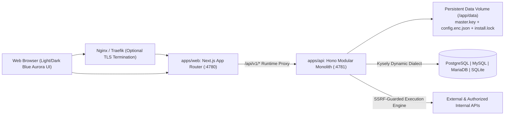

# System Architecture — Meofast

Meofast uses a **Modular Monolith** architecture organized in a clean TypeScript monorepo. It avoids premature microservices while maintaining strict module boundaries, runtime multi-database portability, and single-command Docker deployment.

---

## 1. High-Level Topology



---

## 2. Monorepo Structure

```text
meetofast/
├── apps/
│   ├── api/                        # Hono on Node.js (@hono/node-server)
│   │   ├── src/
│   │   │   ├── core/
│   │   │   │   ├── bootstrap/      # Uninstalled -> Installed state machine & lockfile
│   │   │   │   ├── crypto/         # Native Argon2id, AES-256-GCM vault, CSPRNG tokens
│   │   │   │   ├── database/       # Kysely factory (PG, MySQL, MariaDB, Node SQLite) & migrations
│   │   │   │   └── errors/         # Structured AppError & HTTP exception formatter
│   │   │   ├── middleware/         # Setup guard, Auth session, RBAC, CSRF, Rate limit, Headers
│   │   │   ├── modules/
│   │   │   │   ├── health/         # Container & DB readiness probes
│   │   │   │   ├── setup/          # 7-step First-Time Installation Wizard endpoints
│   │   │   │   ├── auth/           # Login, logout, sessions, registration, password update
│   │   │   │   ├── users/          # User directory, invitations, role/status management
│   │   │   │   ├── workspaces/     # Organizations, workspaces, RBAC members, network policy
│   │   │   │   ├── collections/    # Collections, nested folders, saved requests, import/export
│   │   │   │   ├── environments/   # Environments, AES-256-GCM encrypted variables, .env sync
│   │   │   │   ├── proxy/          # Backend HTTP Request Execution Engine, SSRF guard, assertions
│   │   │   │   └── audit/          # Immutable audit trail & login history queries
│   │   │   ├── app.ts              # Hono application composition (testable without port bind)
│   │   │   └── index.ts            # @hono/node-server entrypoint & graceful shutdown
│   │   └── test/                   # Vitest unit, integration, setup lock, SSRF & DB compatibility suites
│   └── web/                        # Next.js (App Router) + React + Tailwind CSS + Blue Aurora UI
│       ├── src/
│       │   ├── app/
│       │   │   ├── api/[...path]/  # Streaming runtime proxy forwarding /api/* to Hono
│       │   │   ├── setup/          # Standalone First-Time Installation Wizard UI
│       │   │   ├── login/          # Authentication UI
│       │   │   └── page.tsx        # Main API Development Platform Workbench
│       │   ├── components/
│       │   │   ├── ui/             # Strict meorora per-component directories (button/, card/, etc.)
│       │   │   ├── common/         # Shared composed primitives
│       │   │   └── layouts/        # AppShell, SetupShell
│       │   ├── features/
│       │   │   ├── setup/          # 7-step wizard state & API hooks
│       │   │   ├── auth/           # Session hooks & login forms
│       │   │   ├── client/         # Request tabs store (Zustand), URL bar, editors, response viewer
│       │   │   ├── collections/    # Tree explorer, cURL / Postman importer
│       │   │   ├── environments/   # Variable editor & secret vault modal
│       │   │   └── admin/          # Users, Workspaces, SSRF Network Policy & Audit Logs
│       │   ├── lib/                # Fetch client with automatic CSRF header & error parsing
│       │   └── styles/             # tokens.css, themes.css, globals.css (Blue Aurora)
├── packages/
│   └── shared/                     # Shared TypeScript interfaces, Zod schemas & constants
└── deploy/                         # Nginx, Traefik, Docker & lifecycle shell scripts
```

---

## 3. Core Architectural Decisions

### 3.1 Hono Modular Monolith on Node.js
- **Why Hono:** Ultra-fast routing, Web-Standard `Request`/`Response` primitives, first-class TypeScript inference, zero heavy framework reflection overhead, and clean middleware composition.
- **Why Node.js Runtime (`@hono/node-server`):** Provides native `node:crypto` (`argon2`, `aes-256-gcm`), `node:sqlite` (`DatabaseSync`), `node:dns` (pre-connect SSRF IP inspection), and mature TCP drivers (`pg` and `mysql2`) in one unified process.

### 3.2 Dynamic Runtime Multi-Database Layer (Kysely)
Traditional ORMs with build-time code generation (such as Prisma) bind a compiled artifact to a single SQL provider, breaking browser-based database selection. Meofast uses **Kysely** with a runtime `DatabaseManager`:
- `postgresql` -> `PostgresDialect` (`pg.Pool`)
- `mysql` / `mariadb` -> `MysqlDialect` (`mysql2.createPool`)
- `sqlite` -> Custom `NodeSqliteDialect` wrapping `node:sqlite` (`DatabaseSync`) with WAL mode and foreign keys enabled.
- During Step 6 of the Web Setup Wizard, `DatabaseManager.initialize(config)` connects, runs programmatic migrations, and swaps the active database handle in memory—**requiring zero container restarts**.

### 3.3 Same-Origin Runtime API Proxy
`apps/web` exposes `/api/[...path]/route.ts`, streaming requests directly to `INTERNAL_API_URL` (`http://127.0.0.1:4781` locally or `http://api:4781` in Docker Compose). Administrators only expose port `4780` (or reverse-proxy port `80/443 -> 4780`), ensuring `HttpOnly` session cookies and `X-CSRF-Token` headers operate strictly same-origin on any IP address or domain without CORS misconfiguration.

### 3.4 SSRF-Hardened Request Execution Engine
Browser `fetch` cannot inspect custom `User-Agent`/`Cookie` headers or call non-CORS endpoints. Hono's `RequestExecutor`:
1. Interpolates environment/global/dynamic variables (`{{baseUrl}}`, `{{$uuid}}`) and injects configured Auth credentials.
2. Parses the URL and resolves all A/AAAA records via `dns.lookup`.
3. Checks every resolved IP against `SsrfGuard`:
   - **Unconditionally blocked:** Link-local & cloud metadata (`169.254.0.0/16`, `100.100.100.200`, `fe80::/10`, `fd00:ec2::254`).
   - **Policy-controlled:** Loopback (`127.0.0.0/8`, `::1`) and private networks (`10.0.0.0/8`, `172.16.0.0/12`, `192.168.0.0/16`, `fc00::/7`) are blocked by default unless explicitly permitted by the Organization's `network_policy` (configurable by `super_admin` / `org_admin`).
4. Executes the HTTP request with `redirect: 'manual'`, re-validating every `3xx` redirect target against `SsrfGuard` up to `maxRedirects`, enforcing timeout (`AbortSignal.timeout`) and `maxResponseBytes` caps.
5. Evaluates post-response assertions, redacts secret values from execution logs, and stores history in the workspace database.
