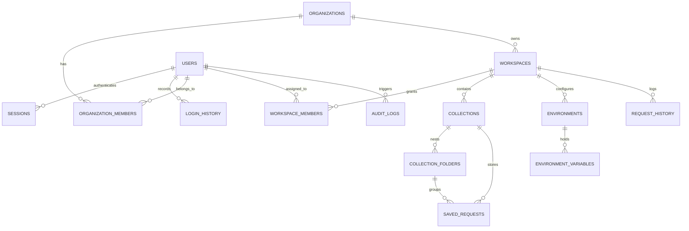

# Database Design — Meofast

Meofast supports **PostgreSQL** (recommended production), **MySQL**, **MariaDB**, and **SQLite** from a single codebase without manual SQL scripts or container rebuilds.

---

## 1. Cross-Engine Portability Rules

To guarantee 100% behavioral parity across all four engines, every Kysely migration and query adheres to strict portability rules:

1. **Primary & Foreign Keys:** Application-generated `UUIDv4` (`crypto.randomUUID()`) stored as `varchar(36)`. Never rely on PostgreSQL-only `uuid` column extensions or `RETURNING *` (insert using generated UUID, then query or construct deterministically).
2. **Timestamps:** Stored as ISO-8601 UTC strings (`varchar(40)`, e.g. `2026-11-16T15:30:00.000Z`) across engines to eliminate timezone drift between SQLite `TEXT`, MySQL `DATETIME` (which lacks timezone offsets), and PostgreSQL `TIMESTAMPTZ`.
3. **Booleans:** Stored as integer `0` / `1` (`integer` / `smallint`) mapped cleanly in TypeScript helpers (`toBool` / `fromBool`) so SQLite, MySQL/MariaDB `TINYINT(1)`, and PostgreSQL `INTEGER` behave identically in `WHERE` clauses.
4. **Structured JSON Columns:** Stored as `text` (using `longtext` on MySQL/MariaDB where payloads like response bodies or collection definitions exceed 64KB) and serialized/validated via Zod in the repository layer.
5. **Identifiers & Case Sensitivity:** All table and column names use lowercase `snake_case` (`<= 48` characters), avoiding reserved SQL keywords (`order` -> `sort_order`, `key` -> `var_key`, `value` -> `var_value`).

---

## 2. Entity-Relationship Overview

---

## 3. Core Schema Specification

### 3.1 System & Authentication

#### `system_settings`
Stores global instance metadata, registration policy, and network security policy.
- `setting_key` (`varchar(100)`, PK)
- `setting_value` (`text`, not null)
- `updated_at` (`varchar(40)`, not null)

Key records seeded during Step 6 installation:
- `installation_completed`: `"true"`
- `app_name`: `"Meofast"`
- `public_url`: `"http://localhost:3000"`
- `default_timezone`: `"UTC"`
- `default_language`: `"en"`
- `registration_mode`: `"invite_only"` (`"invite_only"` | `"open"`)
- `network_policy`: JSON (`{ allowPrivateNetworks: false, allowLocalhost: false, allowedCidrs: [], allowedDomains: [] }`)

#### `users`
- `id` (`varchar(36)`, PK)
- `email` (`varchar(255)`, Unique, lowercase)
- `username` (`varchar(100)`, Unique, lowercase)
- `full_name` (`varchar(160)`, not null)
- `password_hash` (`varchar(512)`, Argon2id PHC string)
- `global_role` (`varchar(40)`, `'super_admin' | 'org_admin' | 'workspace_admin' | 'developer' | 'viewer'`)
- `status` (`varchar(20)`, `'active' | 'deactivated'`)
- `last_login_at` (`varchar(40)`, nullable)
- `created_at` (`varchar(40)`, not null)
- `updated_at` (`varchar(40)`, not null)

#### `sessions`
- `id` (`varchar(36)`, PK)
- `user_id` (`varchar(36)`, FK -> `users.id` ON DELETE CASCADE, indexed)
- `token_hash` (`varchar(128)`, Unique SHA-256 hash of cookie bearer token)
- `csrf_token` (`varchar(128)`, not null)
- `ip_address` (`varchar(80)`, nullable)
- `user_agent` (`varchar(512)`, nullable)
- `expires_at` (`varchar(40)`, indexed)
- `created_at` (`varchar(40)`, not null)

#### `login_history`
- `id` (`varchar(36)`, PK)
- `user_id` (`varchar(36)`, nullable, indexed)
- `email_attempted` (`varchar(255)`, not null)
- `succeeded` (`integer`, `0 | 1`)
- `ip_address` (`varchar(80)`, nullable)
- `user_agent` (`varchar(512)`, nullable)
- `failure_reason` (`varchar(160)`, nullable)
- `created_at` (`varchar(40)`, indexed)

#### `user_invitations`
- `id` (`varchar(36)`, PK)
- `organization_id` (`varchar(36)`, FK -> `organizations.id` ON DELETE CASCADE)
- `workspace_id` (`varchar(36)`, nullable)
- `email` (`varchar(255)`, indexed)
- `role` (`varchar(40)`, not null)
- `token_hash` (`varchar(128)`, Unique)
- `invited_by` (`varchar(36)`, FK -> `users.id`)
- `accepted_at` (`varchar(40)`, nullable)
- `expires_at` (`varchar(40)`, not null)
- `created_at` (`varchar(40)`, not null)

---

### 3.2 Organizations & Workspaces

#### `organizations`
- `id` (`varchar(36)`, PK)
- `name` (`varchar(160)`, not null)
- `slug` (`varchar(120)`, Unique)
- `created_at` (`varchar(40)`, not null)
- `updated_at` (`varchar(40)`, not null)

#### `organization_members`
- `id` (`varchar(36)`, PK)
- `organization_id` (`varchar(36)`, FK -> `organizations.id` ON DELETE CASCADE)
- `user_id` (`varchar(36)`, FK -> `users.id` ON DELETE CASCADE)
- `role` (`varchar(40)`, `'org_admin' | 'member'`)
- `created_at` (`varchar(40)`, not null)
- Unique composite index: `(organization_id, user_id)`

#### `workspaces`
- `id` (`varchar(36)`, PK)
- `organization_id` (`varchar(36)`, FK -> `organizations.id` ON DELETE CASCADE, indexed)
- `name` (`varchar(160)`, not null)
- `slug` (`varchar(120)`, not null)
- `description` (`varchar(500)`, nullable)
- `visibility` (`varchar(20)`, `'team' | 'private'`)
- `created_by` (`varchar(36)`, FK -> `users.id`)
- `created_at` (`varchar(40)`, not null)
- `updated_at` (`varchar(40)`, not null)
- Unique composite index: `(organization_id, slug)`

#### `workspace_members`
- `id` (`varchar(36)`, PK)
- `workspace_id` (`varchar(36)`, FK -> `workspaces.id` ON DELETE CASCADE)
- `user_id` (`varchar(36)`, FK -> `users.id` ON DELETE CASCADE)
- `role` (`varchar(40)`, `'workspace_admin' | 'developer' | 'viewer'`)
- `created_at` (`varchar(40)`, not null)
- Unique composite index: `(workspace_id, user_id)`

---

### 3.3 API Collections, Requests, Environments & Execution

#### `collections`
- `id` (`varchar(36)`, PK)
- `workspace_id` (`varchar(36)`, FK -> `workspaces.id` ON DELETE CASCADE, indexed)
- `name` (`varchar(200)`, not null)
- `description` (`text`, nullable)
- `variables_json` (`text`, default `'[]'`)
- `auth_json` (`text`, default `'{"type":"none"}'`)
- `sort_order` (`integer`, default `0`)
- `created_by` (`varchar(36)`, nullable)
- `created_at` (`varchar(40)`, not null)
- `updated_at` (`varchar(40)`, not null)

#### `collection_folders`
- `id` (`varchar(36)`, PK)
- `collection_id` (`varchar(36)`, FK -> `collections.id` ON DELETE CASCADE, indexed)
- `parent_folder_id` (`varchar(36)`, nullable, self-referential hierarchy)
- `name` (`varchar(200)`, not null)
- `description` (`text`, nullable)
- `variables_json` (`text`, default `'[]'`)
- `sort_order` (`integer`, default `0`)
- `created_at` (`varchar(40)`, not null)
- `updated_at` (`varchar(40)`, not null)

#### `saved_requests`
- `id` (`varchar(36)`, PK)
- `workspace_id` (`varchar(36)`, FK -> `workspaces.id` ON DELETE CASCADE, indexed)
- `collection_id` (`varchar(36)`, FK -> `collections.id` ON DELETE CASCADE, indexed)
- `folder_id` (`varchar(36)`, nullable, indexed)
- `name` (`varchar(200)`, not null)
- `description` (`text`, nullable)
- `method` (`varchar(16)`, `'GET' | 'POST' | 'PUT' | 'PATCH' | 'DELETE' | 'HEAD' | 'OPTIONS'`)
- `url` (`text`, not null)
- `query_params_json` (`text`, default `'[]'`)
- `headers_json` (`text`, default `'[]'`)
- `path_vars_json` (`text`, default `'[]'`)
- `auth_json` (`text`, default `'{"type":"none"}'`)
- `body_json` (`longtext`/`text`, default `'{"mode":"none"}'`)
- `assertions_json` (`text`, default `'[]'`)
- `sort_order` (`integer`, default `0`)
- `created_by` (`varchar(36)`, nullable)
- `created_at` (`varchar(40)`, not null)
- `updated_at` (`varchar(40)`, not null)

#### `environments`
- `id` (`varchar(36)`, PK)
- `workspace_id` (`varchar(36)`, FK -> `workspaces.id` ON DELETE CASCADE, indexed)
- `name` (`varchar(160)`, not null)
- `is_global` (`integer`, `0 | 1`, default `0`)
- `created_by` (`varchar(36)`, nullable)
- `created_at` (`varchar(40)`, not null)
- `updated_at` (`varchar(40)`, not null)

#### `environment_variables`
- `id` (`varchar(36)`, PK)
- `environment_id` (`varchar(36)`, FK -> `environments.id` ON DELETE CASCADE, indexed)
- `var_key` (`varchar(160)`, not null)
- `var_value` (`text`, plaintext when `is_secret = 0`, empty when `is_secret = 1`)
- `encrypted_value` (`text`, AES-256-GCM ciphertext when `is_secret = 1`, nullable)
- `is_secret` (`integer`, `0 | 1`, default `0`)
- `enabled` (`integer`, `0 | 1`, default `1`)
- `sort_order` (`integer`, default `0`)
- `created_at` (`varchar(40)`, not null)
- `updated_at` (`varchar(40)`, not null)

#### `request_history`
- `id` (`varchar(36)`, PK)
- `workspace_id` (`varchar(36)`, FK -> `workspaces.id` ON DELETE CASCADE, indexed)
- `user_id` (`varchar(36)`, FK -> `users.id` ON DELETE CASCADE, indexed)
- `saved_request_id` (`varchar(36)`, nullable)
- `method` (`varchar(16)`, not null)
- `url` (`text`, redacted resolved URL)
- `request_snapshot_json` (`longtext`/`text`, secret-masked request metadata)
- `response_status` (`integer`, nullable)
- `response_status_text` (`varchar(120)`, nullable)
- `duration_ms` (`integer`, not null)
- `response_size_bytes` (`integer`, not null)
- `response_headers_json` (`text`, default `'{}'`)
- `response_body_preview` (`longtext`/`text`, capped preview)
- `assertion_results_json` (`text`, default `'[]'`)
- `error_message` (`text`, nullable)
- `created_at` (`varchar(40)`, indexed)

#### `audit_logs`
- `id` (`varchar(36)`, PK)
- `organization_id` (`varchar(36)`, nullable, indexed)
- `workspace_id` (`varchar(36)`, nullable, indexed)
- `actor_user_id` (`varchar(36)`, nullable, indexed)
- `actor_email` (`varchar(255)`, nullable)
- `action` (`varchar(120)`, e.g. `'setup.completed'`, `'user.created'`, `'workspace.network_policy_updated'`)
- `target_type` (`varchar(80)`, not null)
- `target_id` (`varchar(120)`, nullable)
- `metadata_json` (`text`, secret-scrubbed context)
- `ip_address` (`varchar(80)`, nullable)
- `created_at` (`varchar(40)`, indexed)
