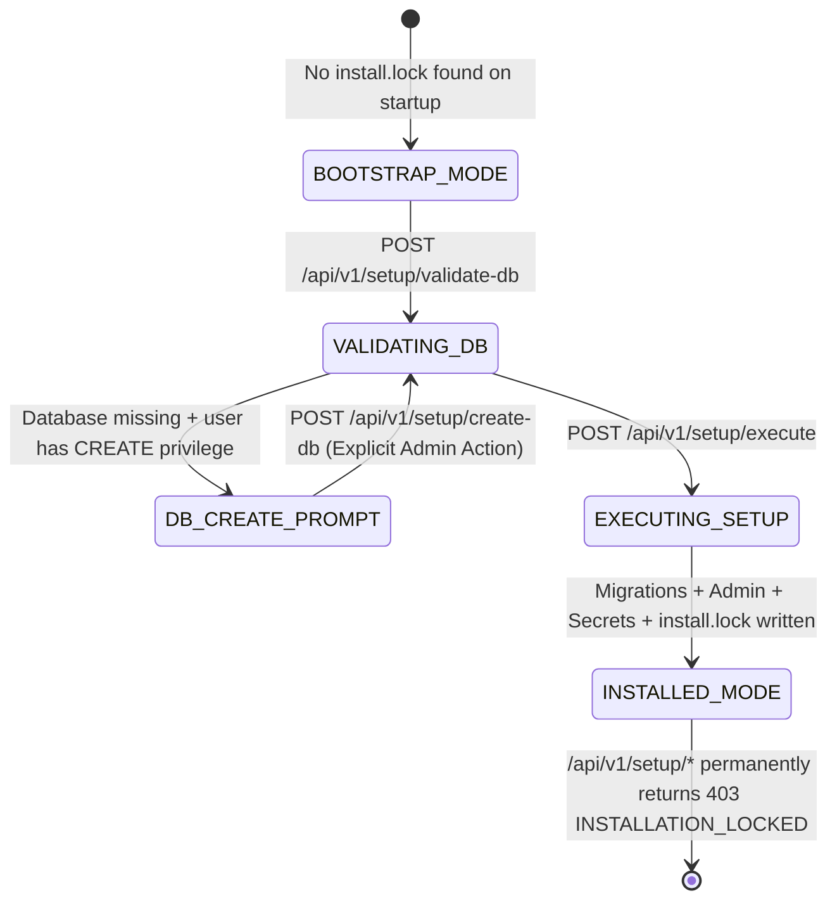

# First-Time Installation Flow — Meofast

Meofast provides a browser-complete, n8n-style first-time installation wizard so administrators never need to manually edit `.env` files or run raw SQL statements to provision an instance.

---

## 1. Bootstrap Lifecycle State Machine

### How Bootstrap Works Without a Pre-Configured Database
1. On server boot, `BootstrapManager` inspects `MEOFAST_DATA_DIR` (defaults to `./data` locally or `/app/data` in Docker):
   - Ensures a 256-bit master encryption key exists (`MEOFAST_MASTER_KEY` env var or generated `data/master.key` with `0600` file mode).
   - Checks for `data/install.lock` and `data/config.enc.json`.
2. **When Uninstalled (`BOOTSTRAP_MODE`):**
   - `GET /api/v1/setup/status` returns `{ installed: false, version: "1.0.0" }` and sets a `HttpOnly; SameSite=Lax` cookie `meofast_setup_csrf` plus returns the matching CSRF token for the wizard session.
   - All `/api/v1/*` operational endpoints return `503 SETUP_REQUIRED`, causing `apps/web` to route any page directly to `/setup`.
3. **When Installed (`INSTALLED_MODE`):**
   - `BootstrapManager` decrypts `data/config.enc.json` in memory using `master.key`, initializes Kysely against the configured PostgreSQL / MySQL / MariaDB / SQLite database, verifies `system_settings.installation_completed === 'true'`, and serves the main platform.
   - Every mutating `/api/v1/setup/*` endpoint is permanently blocked by `setupGuardMiddleware` with HTTP `403 INSTALLATION_LOCKED`.

---

## 2. Seven-Step Wizard Specification

### Step 1: Welcome
- Displays Meofast identity, version (`v1.0.0`), 100% Free & Open-Source self-hosted guarantee, and deployment readiness indicator.
- Action: **Get Started**.

### Step 2: Database Selection
Administrator selects one of four supported engines:
- **PostgreSQL** *(Recommended for production & company deployments)* — Default port `5432`, SSL mode (`disable`, `prefer`, `require`).
- **MySQL** — Default port `3306`, SSL mode (`disable`, `prefer`, `require`).
- **MariaDB** — Default port `3306`, SSL mode (`disable`, `prefer`, `require`).
- **SQLite** *(Recommended for personal VPS / single-node lightweight setups)* — Default file `meofast.sqlite` inside the persistent storage directory (`./data` or `/app/data`).

### Step 3: Database Connection Validation
Before advancing, `POST /api/v1/setup/validate-db` verifies:
1. **Driver availability** (`pg`, `mysql2`, or `node:sqlite`).
2. **Reachability & Credentials** (TCP handshake + auth or filesystem directory write permission for SQLite).
3. **Database Existence:**
   - If the database does **not** exist (`3D000` in PostgreSQL or `ER_BAD_DB_ERROR` / `1049` in MySQL/MariaDB), Meofast connects to the maintenance database (`postgres` or server root) to check connectivity and returns `databaseExists: false` without touching any schema.
   - The UI presents an **explicit confirmation button ("Create Database `<name>`")** calling `POST /api/v1/setup/create-db`. Meofast never silently creates or overwrites an existing database.
4. **Permissions & Compatibility:** Checks SQL engine version and verifies temporary table/DDL capability.

### Step 4: Initial Super Administrator Account
Fields:
- Full Name (`2–160` chars)
- Email Address (valid email, normalized lowercase)
- Username (`3–40` chars, `[a-z0-9._-]`)
- Password & Confirm Password (minimum 10 characters, uppercase, lowercase, number, and symbol; hashed with **Argon2id** `m=65536, t=3, p=4`).
- Strictly zero default admin accounts or backdoor credentials.

### Step 5: Application Configuration
Fields:
- Application Name (default: `Meofast`)
- Public Application URL (auto-populated from browser origin, e.g., `http://YOUR_SERVER_IP:3000`)
- Default Timezone (auto-detected IANA timezone, e.g., `Asia/Jakarta` or `UTC`)
- Default Language (`en` / `id`)
- Organization Name (e.g., `Acme Engineering` or `Personal Workspace`)

### Step 6: Atomic Installation Execution
`POST /api/v1/setup/execute` executes in an ordered, auditable pipeline:
1. Re-validates database connection & CSRF token.
2. Encrypts database credentials with AES-256-GCM (`data/config.enc.json`, `0600` permissions).
3. Initializes the live Kysely connection pool in memory.
4. Executes cross-dialect schema migrations (`001_initial_schema`).
5. Verifies no administrator already exists (prevents race/duplicate bootstrap).
6. Seeds `system_settings`, creates the initial `organization`, `Default Workspace`, starter `Sample REST API` collection, and `Development` environment.
7. Hashes password with Argon2id and creates the `super_admin` user.
8. Writes initial `audit_logs` record (`setup.completed`).
9. Writes atomic `data/install.lock` with installation timestamp and schema version, activates runtime `INSTALLED_MODE` immediately (zero container restart required), and issues an authenticated `HttpOnly` session cookie.

### Step 7: Installation Complete
Displays installation status, Meofast version, active database dialect, administrator email, and **Go to Dashboard** button.

---

## 3. Security & Emergency Recovery Procedure

- **No Secret Leakage:** Database passwords and admin passwords are redacted from all request logs and error responses.
- **CSRF & Rate Limiting:** Setup endpoints enforce bootstrap CSRF validation and IP rate limiting (`20 req/min`) to prevent automated brute-forcing of internal database hosts during initial provisioning.
- **Documented Server-Admin Reset Procedure:** Web requests can **never** reset an installed instance. If an infrastructure owner loses all Super Admin access or needs to re-run setup on a test machine, they must have shell access to the host/container:
  1. Back up `/app/data` (or `./data`).
  2. Stop or exec into the API container and delete `/app/data/install.lock` and `/app/data/config.enc.json` (or run `npm --workspace @meofast/api run setup:reset -- --confirm`).
  3. Restart the container to re-enter `BOOTSTRAP_MODE` against a fresh database.
