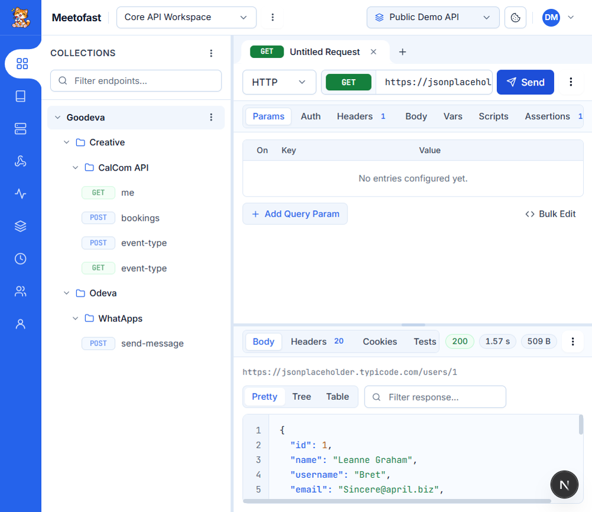
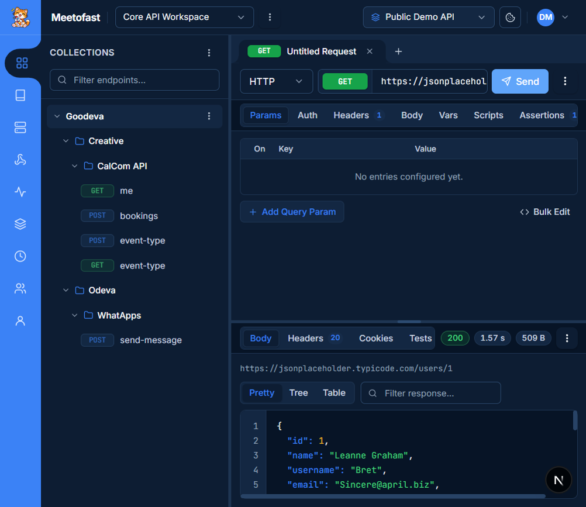
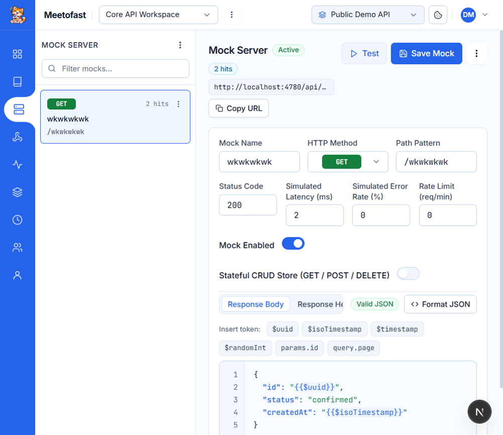
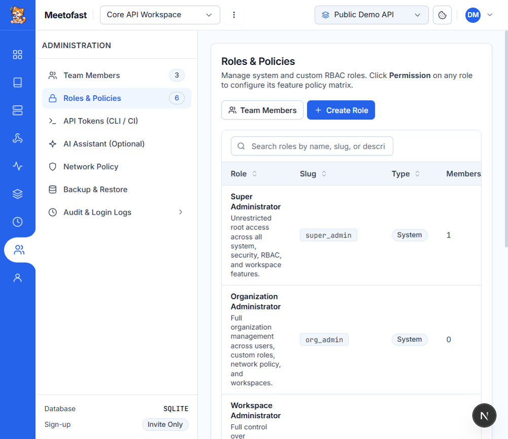

<p align="center">
  
</p>

<h1 align="center">Meetofast</h1>

<p align="center">
  <strong>Open-Source, 100% Free, Self-Hosted Web API Development Platform.</strong>
</p>

<p align="center">
  <a href="./LICENSE"></a>
  = 24.7" />
  
</p>

Meetofast is a modern, web-first API client, workspace collaboration hub, automated assertion runner, mock server, and team API governance platform designed to run entirely on your own infrastructure—personal VPS, company servers, private cloud, or localhost.

- **100% Free & Apache-2.0 Licensed:** Zero paywalls, zero seat limits, zero collection caps, zero cloud account requirements, and zero telemetry.
- **Browser-Complete Setup Wizard:** Deploy with `docker compose up -d` and configure **PostgreSQL**, **MySQL**, **MariaDB**, or **SQLite** directly in your browser—no manual `.env` editing or SQL scripts required.
- **SSRF-Hardened Backend Execution Engine:** Executes HTTP, GraphQL, WebSocket, SOAP, and gRPC requests via a Hono backend engine while blocking cloud metadata SSRF (`169.254.169.254`) and offering administrator-governed policies for internal private APIs.
- **Built-in Mock Server, Webhooks, Monitors & Custom RBAC:** Stateful CRUD mocks with fault injection, inbound webhook inspector, scheduled monitors & load testing, and Laravel Policy-style per-feature RBAC matrices.
- **Blue Aurora UI:** Clean, high-density interface with **Light theme by default** and instant Dark theme switching.

---

## Screenshots

<table>
  <tr>
    <td align="center"><strong>API Workbench (Light Mode)</strong><br /></td>
    <td align="center"><strong>API Workbench (Dark Mode)</strong><br /></td>
  </tr>
  <tr>
    <td align="center"><strong>Built-in Mock Server</strong><br /></td>
    <td align="center"><strong>Custom RBAC Roles & Policies</strong><br /></td>
  </tr>
</table>

---

## Quick Start (Docker Compose)

```bash
git clone https://github.com/meocode/meetofast.git
cd meetofast
docker compose up -d
```

Open **`http://YOUR_SERVER_IP:4780`** in your browser. Meetofast automatically redirects to `/setup` on first launch so you can choose your database, validate connectivity, create your Argon2id-secured Super Administrator account, and launch your workspace.

---

## Technology Stack

| Layer | Technology |
|---|---|
| **Frontend (`apps/web`)** | Next.js (App Router), React, TypeScript, Tailwind CSS, TanStack Query, Zustand, Blue Aurora UI primitives |
| **Backend (`apps/api`)** | Hono on Node.js (`@hono/node-server`), TypeScript, Modular Monolith |
| **Database Layer** | Kysely dynamic multi-dialect engine (`PostgreSQL`, `MySQL`, `MariaDB`, `SQLite` via `node:sqlite`) |
| **CLI Runner (`packages/cli`)** | `@meofast/cli` (`meofast run`) for CI/CD pipelines with JUnit XML, JSON, and HTML reports |
| **Security** | Native RFC 9106 `Argon2id`, `AES-256-GCM` secret vault, `HttpOnly` sessions, CSRF tokens, Personal API Tokens (`mf_pat_...`), DNS-aware SSRF guard |
| **Shared (`packages/shared`)** | Zod schemas & TypeScript contracts |

---

## Local Development

### Prerequisites
- Node.js `>= 24.7.0` (providing built-in `node:crypto` Argon2id and `node:sqlite`)
- `npm` `>= 10`

### Run Locally

```bash
npm install
npm run build --workspace=@meofast/shared
npm run dev
```

- Web UI: `http://localhost:4780`
- Hono API (internal): `http://localhost:4781` (proxied automatically via `http://localhost:4780/api/v1/*`)

### Quality Checks & Tests

```bash
npm run typecheck
npm test
npm run build
```

---

## Documentation Index

- [Product Requirements (PRD.md)](./PRD.md)
- [System Architecture (ARCHITECTURE.md)](./ARCHITECTURE.md)
- [Database Design (DATABASE_DESIGN.md)](./DATABASE_DESIGN.md)
- [First-Time Installation Flow (INSTALLATION_FLOW.md)](./INSTALLATION_FLOW.md)
- [Deployment Guide (DEPLOYMENT.md)](./DEPLOYMENT.md)
- [Design System (DESIGN.md)](./DESIGN.md)
- [Roadmap (ROADMAP.md)](./ROADMAP.md)
- [Installation Guide (docs/INSTALLATION.md)](./docs/INSTALLATION.md)
- [Upgrade Guide (docs/UPGRADE.md)](./docs/UPGRADE.md)
- [Backup & Restore Guide (docs/BACKUP_RESTORE.md)](./docs/BACKUP_RESTORE.md)
- [REST API Reference (docs/API.md)](./docs/API.md)
- [Security Policy (SECURITY.md)](./SECURITY.md)
- [Contributing Guide (CONTRIBUTING.md)](./CONTRIBUTING.md)

---

## License

Licensed under the [Apache License, Version 2.0](./LICENSE). Every core and enterprise collaboration feature in Meetofast is permanently free and open-source.
